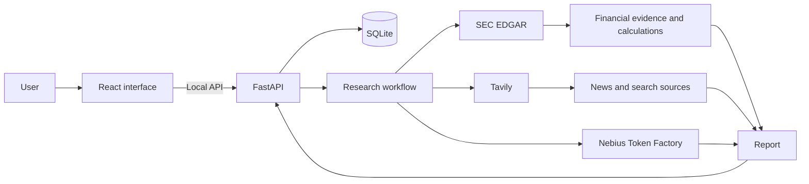
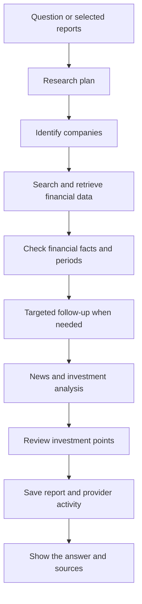

# Architecture

Seldon runs as a local web application. The React interface sends a research question to a FastAPI backend, which coordinates the research and stores the resulting report in SQLite. The backend makes the external requests.

Nebius helps plan the research, analyze information and review the investment view. Tavily searches the web. SEC EDGAR supplies company filings and structured financial facts. Each serves a different role in the report.

## From question to report

The workflow matches financial observations to their issuers, reporting periods, units and source records. It calculates measures such as free cash flow when the inputs are comparable. News and financial evidence are then available to investment synthesis. The review records findings at the level of individual points.

Comparison research uses saved reports as context and prioritizes the comparative answer before the news stage. Provider activity records calls made during the task. The interface displays the report, financial records and links to their sources.

The main implementation is in `backend/agent/`, with provider adapters in `backend/providers/`, evidence and financial processing in `backend/evidence/` and `backend/financial/`, and the interface in `frontend/src/`. The API and report contracts are in `contracts/`.