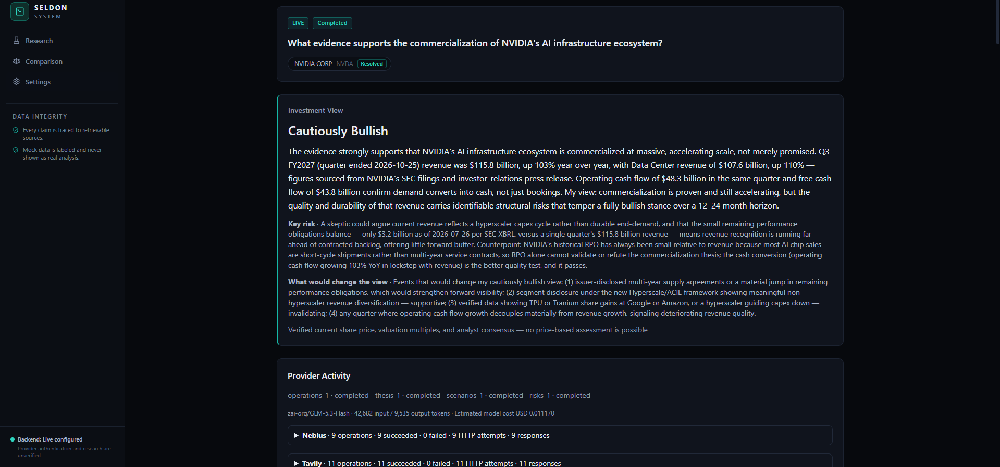
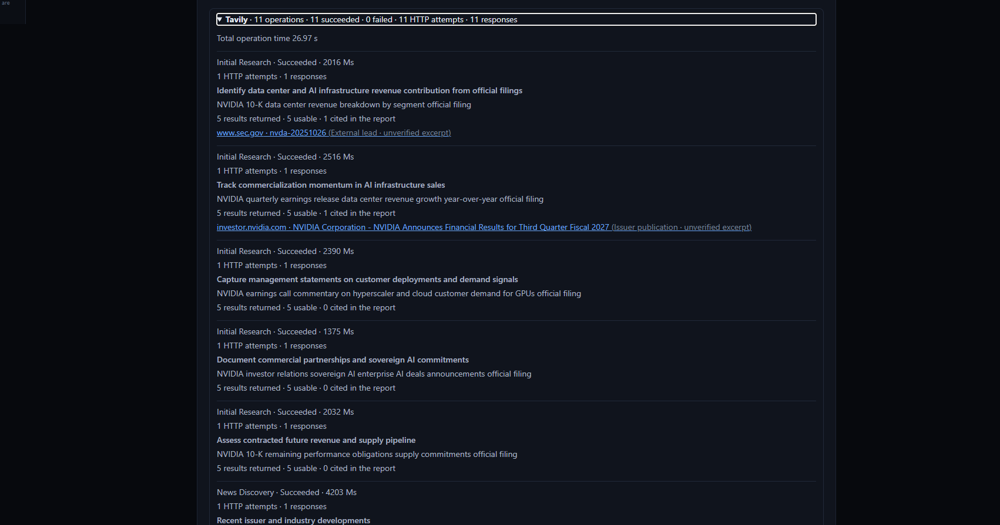

# How Seldon researches

When someone asks about a company, the model first works out which company and financial questions are relevant. For example, a question about NVIDIA's AI infrastructure can lead it to look for segment revenue, customer demand and evidence of cash generation. An ambiguous company name can lead to a search for an official issuer record before the agent retrieves filings.

Tavily finds recent material, while SEC EDGAR supplies filings and structured financial facts. The agent may run a targeted follow-up for a gap, a recent development or evidence that challenges its first reading. It keeps the source links and uses a shared evidence record so the analysis can point back to the material it actually used.

Financial checks cover the issuer, period, currency and accounting scope. When the inputs match, Seldon can calculate measures such as free cash flow and link the result to its inputs. The investment analysis uses those figures alongside selected external information to explain the agent's judgment, its main risks and what would change it.

## A real NVIDIA report

One saved live report asked, “What evidence supports the commercialization of NVIDIA's AI infrastructure ecosystem?” The agent took a cautiously bullish view after reviewing revenue and cash flow. It weighed the strength of current demand against the uncertainty of future spending by large cloud customers.

The Tavily activity shows what the agent searched for, how many results it received and which results were cited. Some searches returned useful leads without producing a citation in the final report.

The [architecture diagram](ARCHITECTURE.md) shows how these stages fit together.
