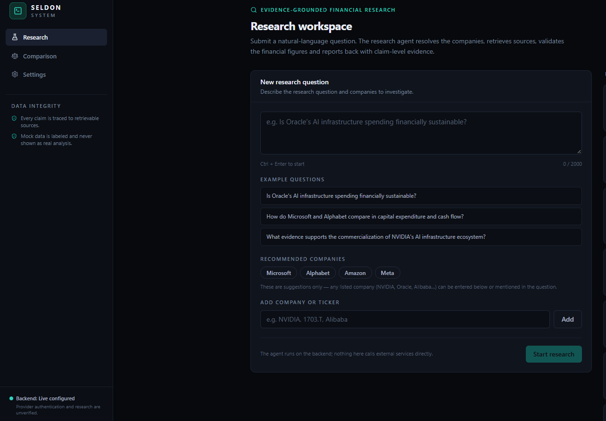
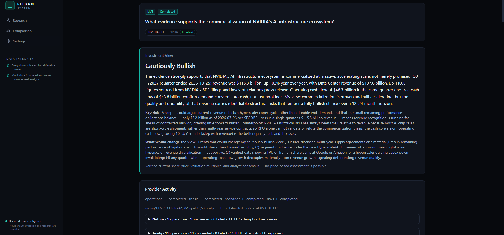
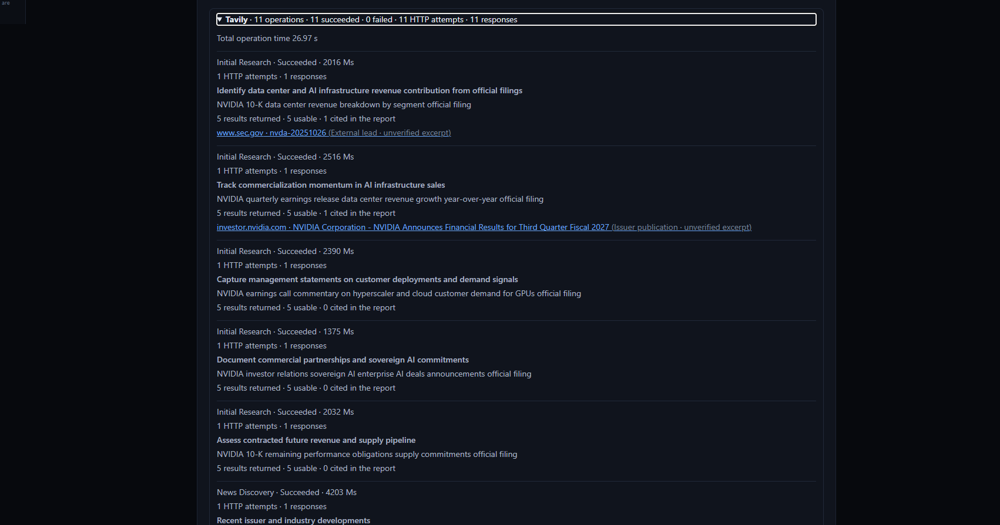
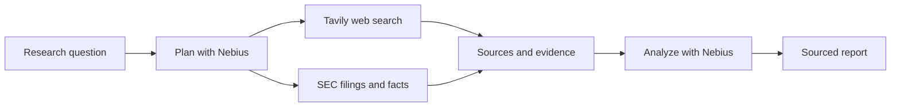

# Seldon

Seldon is a financial research agent for anyone who wants to understand what's driving a public company. Ask a question in plain English. Seldon searches for recent developments, checks financial figures against SEC filings, and gives you an investment view with sources you can open.



## Why I built it

The name **Seldon** is inspired by Hari Seldon from Isaac Asimov's *Foundation* series. Through psychohistory, he sought to understand and predict the future of a Galactic Empire by studying patterns in human society.

Asimov's imagination, including his famous Three Laws of Robotics, inspired my curiosity about artificial intelligence when I was a child. Those stories made me wonder what intelligent machines might one day achieve.

That curiosity eventually grew into a bigger ambition. I want to build a company that advances AI and puts it to work in the real world. One problem I care about is information asymmetry. Public information is widely available, but finding it and making sense of it still takes time and experience.

Seldon is one project through which I explore that idea. For the ODSC × Nebius Hackathon, I built it around a task I find worth doing well: following a financial question from the first search to a view I can check against the evidence.

## A real research example

I asked, “What evidence supports the commercialization of NVIDIA's AI infrastructure ecosystem?” The live report used NVIDIA's revenue and cash flow to explain a cautiously bullish view. It also explained why strong results alone couldn't settle how long customer spending would hold up.



The report recorded nine Nebius operations, eleven Tavily operations and two SEC EDGAR operations. Open **Provider Activity** to see what the agent searched for and which results it cited. Select a financial figure to inspect the fiscal period and open its filing.



## How the agent works

Nebius Token Factory runs the model that plans the research and develops the answer. Tavily retrieves current web sources. SEC EDGAR supplies filings and structured financial data. The agent follows up when the first round leaves a question open, checks which financial figures can be compared, and draws on selected news and filings to explain its view. Saved reports can also be used to answer a new question about several companies.



Read more in [Architecture](ARCHITECTURE.md) and [How Seldon researches](EXPLANATION.md).

## Getting started

Install Git, Python 3.12 and Node.js 22.14 or newer. Run the commands below from the repository root. On GitHub, use **Code** to copy the clone URL or download the ZIP.

### Windows

In PowerShell:

```powershell
python -m venv .venv
.\.venv\Scripts\python.exe -m pip install -c requirements-constraints.txt -e '.[test]'
npm.cmd ci --prefix frontend
.\start.ps1
```

### macOS or Linux

```sh
python3 -m venv .venv
. .venv/bin/activate
python -m pip install -c requirements-constraints.txt -e '.[test]'
npm ci --prefix frontend
npm run build --prefix frontend
python -m uvicorn backend.app:app --host 127.0.0.1 --port 8000
```

FastAPI serves the built frontend. Open [Seldon](http://127.0.0.1:8000) after the server starts. If port 8000 is in use, choose another port with `-Port` on Windows or `--port` with Uvicorn. For frontend development, start the backend on port 8000 and run `npm run dev --prefix frontend` in another terminal. Vite serves the development UI on port 5173 and forwards API requests to port 8000.

### Connect the providers

1. Open **Settings** in Seldon and save your own Nebius Token Factory and Tavily API keys. The browser submits them to the local backend, which saves them in a private settings file and shows their configuration status.
2. If SEC is unconfigured, save a valid SEC contact email in Settings.
3. Return to **Research**, enter a question and click **Start research**.

The default live providers are Nebius, Tavily and SEC EDGAR. The default model is `zai-org/GLM-5.3-Flash`. For file-based setup, copy [`.env.example`](.env.example) to `.env` and fill in `NEBIUS_API_KEY`, `TAVILY_API_KEY` and `SEC_CONTACT_EMAIL`. The example includes the optional model, research limits and storage settings. Keep `.env` private. After a restart, inherited environment variables or a populated `.env` take precedence over keys saved in Settings.

To try the app without keys, set `MODEL_PROVIDER=mock`, `SEARCH_PROVIDER=mock` and `FINANCIAL_DATA_PROVIDER=mock` in `.env` before starting. Reports from this mode are labeled **Mock**. For live research, remove those overrides and restart.

### Read or compare reports

Open the investment view first, then follow its sources, explore the news and click financial metrics to see where the figures came from. To compare companies, save at least two reports, select them on **Comparison**, and ask a comparative question.

## Demo

Video coming soon. See [Demo](DEMO.md) for the walkthrough.
